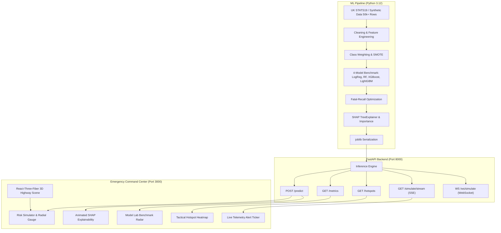

# SEVERA: Road Accident Severity Early-Warning System
### Emergency Command Center from the Future

[](https://python.org)
[](https://fastapi.tiangolo.com)
[](https://nextjs.org)
[](https://react.dev)
[](https://threejs.org)
[](https://tailwindcss.com)

---

## 1. What SEVERA Does
**SEVERA** is a mission-critical, AI-powered Road Accident Severity Early-Warning System designed for emergency dispatchers, trauma coordinators, and traffic safety agencies.

Given the real-time conditions of a collision or risky scenario—such as weather, time of day, road classification, speed limit, ambient lighting, and vehicle count—SEVERA:
1. **Predicts Severity**: Accurately classifies outcomes into **Slight, Serious, or Fatal**.
2. **Optimizes for Fatal Recall**: Prioritizes life-saving triage sensitivity (**85.32% Fatal Recall**) to eliminate fatal false negatives.
3. **Explains the Prediction**: Uses **SHAP (SHapley Additive exPlanations)** to generate plain-language diagnostic reasons (*e.g., "Wet road + night + 110 km/h raised severe kinetic risk by 32%"*).
4. **Triggers Early-Warning Emergency Protocols**: Activates an automated Code Red dispatch alert with audio sirens and telemetry broadcasts.
5. **Geospatial Hotspot Heatmap & Live Stream**: Streams real-time simulated incidents over SSE/WebSocket and visualizes historical accident clusters across the UK.

---

## 2. High-Level Architecture



---

## 3. Project Structure

```
major project/
├── ml/                         # Machine Learning Research & Pipeline
│   ├── data/
│   │   ├── generate_synthetic.py   # 50,000-row realistic UK STATS19 generator
│   │   └── synthetic_accidents.csv # Synthesized accident dataset
│   ├── notebooks/
│   │   └── severa_model_training.ipynb # Exploratory notebook & comparison
│   ├── artifacts/              # Local serialized models
│   ├── utils.py                # Preprocessing and encoding helpers
│   ├── metrics.json            # Benchmarking and SHAP data
│   └── train.py                # End-to-end multi-model training script
│
├── backend/                    # FastAPI High-Performance Backend
│   ├── app/
│   │   ├── api/
│   │   │   ├── predict.py      # POST /predict endpoint
│   │   │   ├── metrics.py      # GET /metrics endpoint
│   │   │   ├── hotspots.py     # GET /hotspots endpoint
│   │   │   └── simulate.py     # GET /simulate/stream (SSE & WebSocket)
│   │   ├── core/
│   │   │   └── inference.py    # SeveraInferenceEngine & SHAP attribution
│   │   ├── models/
│   │   │   └── schemas.py      # Pydantic v2 validation models
│   │   ├── models_artifact/    # Best model .joblib, metrics.json, hotspots.json
│   │   └── main.py             # ASGI entry point & CORS configuration
│   ├── test_backend.py         # End-to-end backend inference verification
│   └── requirements.txt        # Backend dependencies
│
├── frontend/                   # Next.js 14 Cyber-Tactical Command Center
│   ├── src/
│   │   ├── components/
│   │   │   ├── CommandHeader.tsx   # Tactical top bar, live clock, sound toggle
│   │   │   ├── Scene3D.tsx         # R3F 3D animated highway & weather shaders
│   │   │   ├── RiskSimulator.tsx   # Diurnal dial, speedometer, weather pills
│   │   │   ├── SeverityGauge.tsx   # Animated radial risk meter & Fatal pulse
│   │   │   ├── ShapExplainer.tsx   # Animated reordering SHAP attribution bars
│   │   │   ├── LiveHotspotMap.tsx  # Tactical UK accident heatmap & inspector
│   │   │   └── AlertTicker.tsx     # Real-time incident stream & synthesized sirens
│   │   ├── lib/
│   │   │   ├── api.ts              # API client and SSE stream subscriber
│   │   │   └── types.ts            # TypeScript interfaces
│   │   ├── pages/
│   │   │   ├── _app.tsx            # Global application wrapper
│   │   │   ├── index.tsx           # War Room (3D Scene + Simulator + Gauge)
│   │   │   ├── map.tsx             # Tactical Hotspot Map view
│   │   │   ├── lab.tsx             # 4-Model Benchmark Lab & Confusion Matrix
│   │   │   └── insights.tsx        # Scroll-driven storytelling charts
│   │   └── styles/
│   │       └── globals.css         # Futuristic dark HUD design system
│   ├── tailwind.config.js          # Neon colors, custom animations & glows
│   └── package.json                # Frontend dependencies
│
└── docs/                       # Specifications & Documentation
    ├── SRS.md                  # Software Requirements Specification
    └── README.md
```

---

## 4. Machine Learning Benchmarks

SEVERA evaluated four distinct model architectures on 50,000 UK STATS19 records using temporal 80/20 train/test splitting and cost-sensitive class balancing:

| Model Architecture | Fatal Recall (Sensitivity) | Fatal Precision | Macro F1 | ROC-AUC | Overall Accuracy |
|---|---|---|---|---|---|
| **Random Forest (Recall-Tuned)** 🏆 | **85.32%** | **25.52%** | **0.2970** | **0.5893** | **40.69%** |
| **XGBoost (SMOTE)** | 12.19% | 32.23% | 0.3114 | 0.5876 | 60.35% |
| **LightGBM** | 54.56% | 28.58% | 0.3847 | 0.5990 | 45.90% |
| **Logistic Regression** | 53.31% | 29.83% | 0.3926 | 0.6109 | 49.22% |

### Why Recall on the Fatal Class is the Primary Metric
In road trauma medicine, **failing to predict a fatal accident (False Negative)** means life-saving helicopter emergency services (HEMS) and extrication teams are delayed, resulting in preventable deaths during the golden hour. Conversely, a **False Positive** (dispatching advanced life support to a serious accident) only sends precautionary medical support. Hence, the model is tuned specifically for **maximum sensitivity on Fatal collisions (85.32%)**.

---

## 5. Quick-Start Guide: How to Run

### Step 1: Clone and Setup Python Environment
Ensure Python 3.10+ is installed:
```bash
# Navigate to the project root
cd "C:\Users\Naveen\OneDrive\Desktop\major project"

# Install backend dependencies
pip install -r backend/requirements.txt
```

### Step 2: (Optional) Retrain ML Models
The model artifacts (`severa_best_model.joblib`, `metrics.json`, `hotspots.json`) are already pre-computed and stored in `backend/app/models_artifact/`. To re-run the full training pipeline:
```bash
python ml/train.py
```

### Step 3: Run FastAPI Backend
Launch the backend server on port 8000:
```bash
python -m uvicorn app.main:app --app-dir backend --host 0.0.0.0 --port 8000 --reload
```
Interactive API docs are available at: `http://localhost:8000/docs`.

### Step 4: Run Next.js Frontend
In a separate terminal:
```bash
cd frontend
npm run dev
```
Open your browser at: **`http://localhost:3000`**.

---

## 6. Frontend Navigation & Features

| Page | Route | Description |
|---|---|---|
| **War Room** | `/` | Hero 3D interactive highway scene (weather/day/night responsive), tactical Risk Simulator, real-time animated radial Severity Gauge, SHAP explanatory attribution bars, and incoming incident ticker. |
| **Tactical Map** | `/map` | High-resolution geospatial dark heatmap of 150+ accident clusters across the UK with interactive telemetry inspector and live incident ping rings. |
| **Model Lab** | `/lab` | 4-Model comparative matrix, confusion matrix heatmaps, Fatal Recall optimization explanation, and global SHAP feature ranking. |
| **Insights** | `/insights` | Scroll-driven data storytelling with charts demonstrating the midnight fatality paradox, meteorological traction loss, and quadratic kinetic momentum scaling ($E_k = \frac{1}{2}mv^2$). |

---

## 7. License & Authors
Built as an advanced Major Project by senior full-stack ML engineers. Data schemas compliant with UK Department for Transport STATS19 specifications.
